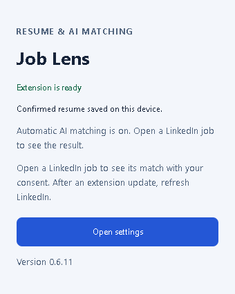
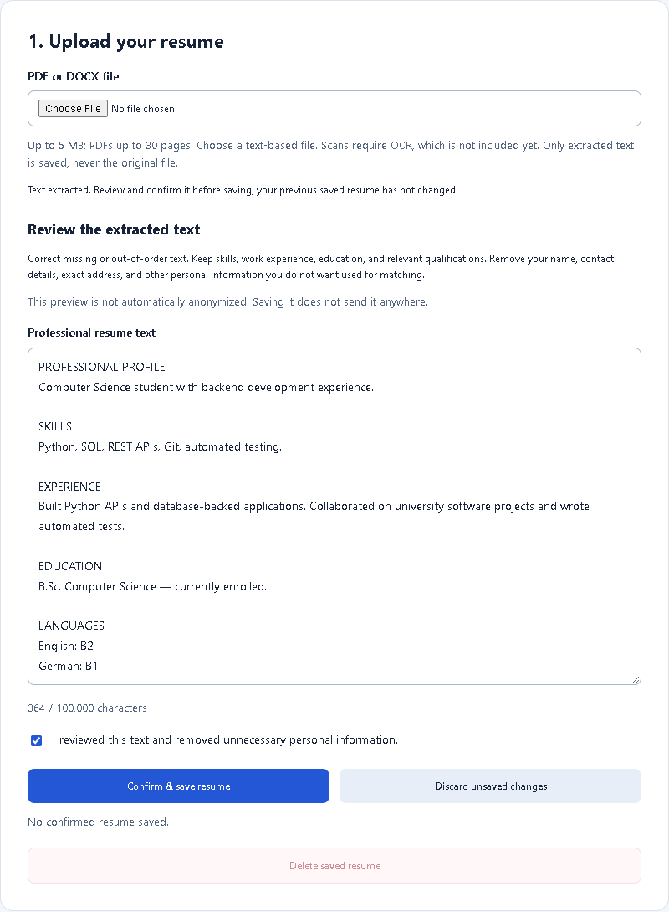
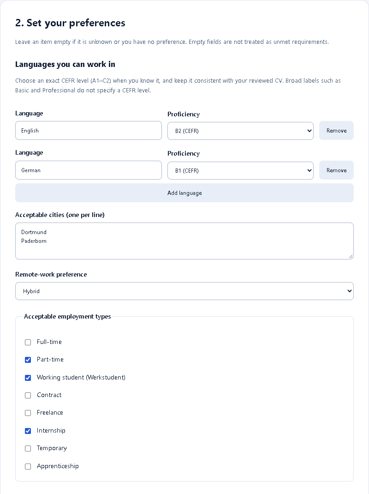
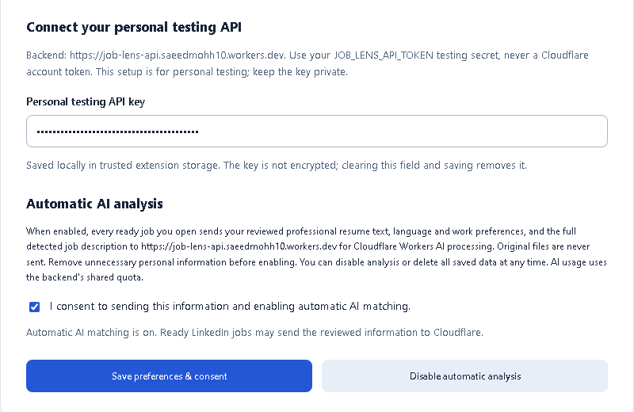
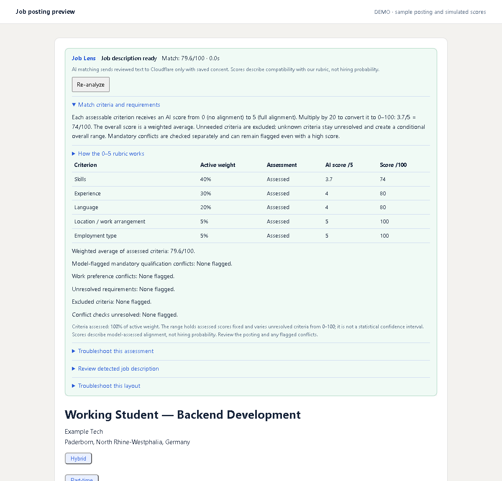
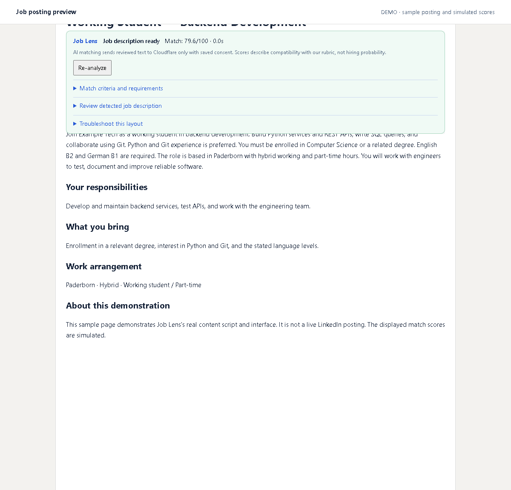

# Job Lens

A Chrome extension that compares your resume and preferences with LinkedIn job postings.

## Features

- Upload text-based PDF or DOCX resumes, review the extracted text, and edit it before saving.
- Save preferred languages, proficiency levels, cities, work arrangements, and employment types, including working student (Werkstudent).
- Automatically detect the opened LinkedIn job, including its location and work-type header, and update the preview when switching postings.
- Show AI criterion scores on a 0–5 rubric, converted to 0–100 and combined with configurable weights in a sticky bar.
- Preserve preferred and conditional requirements, keep unknown or invalid answers unresolved, and flag mandatory qualification and work preference conflicts separately.
- Reuse cached results and discard outdated responses when jobs or saved information change.
- Store confirmed resume text and preferences locally, with consent and deletion controls.

Resume extraction happens locally. With consent, reviewed text, preferences, and the opened job description are sent to Cloudflare for matching. Scanned PDFs require OCR, which is not supported yet.

## How it works

Screenshots show the real extension with sample data and simulated match scores.

### 1. Open Job Lens

Click the extension icon, then **Open settings**.



### 2. Upload your resume

Choose a PDF or DOCX, review the extracted text, then confirm and save it.



### 3. Set your preferences

Add languages, cities, work arrangement, and acceptable employment types, including working student.



### 4. Enable matching

Enter your personal testing API key and save your consent to automatic AI analysis.



### 5. Review a job match

Open a LinkedIn posting to see criterion scores and separate conflict checks. **3.7/5 = 74/100**; unknown criteria stay unresolved.



### 6. Keep the result visible

The sticky panel stays visible while scrolling the posting. Expand its details or click **Re-analyze** for a fresh assessment.



## AI model

Job Lens uses **Clef Flash** (`@cf/cloudflare/clef-flash`), Cloudflare's fast 9B decision model on Workers AI. It evaluates supplied information against typed questions and returns structured choices, scores, and option probabilities. [Model documentation](https://developers.cloudflare.com/workers-ai/models/clef-flash/).

Clef follows the **System One API**, also used by Jev. The goal of these decision models is to make quick, bounded decisions for tasks such as classification, routing, and rubric scoring, without generating long text answers. [Cloudflare's introduction](https://developers.cloudflare.com/changelog/product/workers-ai/#introducing-clef-cloudflares-first-open-source-decision-models-now-on-workers-ai).

Job Lens assesses qualifications and languages separately from work preferences, then calculates a weighted average. Incomplete assessments show a provisional range. Scores describe alignment with the rubric, not hiring probability.

## Installation

Requires Node.js 22.13+ and Chrome 125+.

```sh
npm ci
npm run build
```

1. Open `chrome://extensions` and enable **Developer mode**.
2. Click **Load unpacked** and select the project's `dist` folder.
3. Follow the [backend setup](backend/README.md), then open Job Lens settings to upload your resume, enter your personal testing API key, and enable matching with consent.
4. Open a LinkedIn job to see its assessment. See [verification instructions](docs/VERIFY_MATCHING.md).

After updating the extension, reload it in `chrome://extensions` and refresh your LinkedIn tabs.

## Privacy

Read the [privacy policy](PRIVACY.md) and contact [support](https://github.com/saeed-mh/jobLens/issues) without posting private CVs or API keys. Saved resume text and the testing key are not encrypted by the extension.
